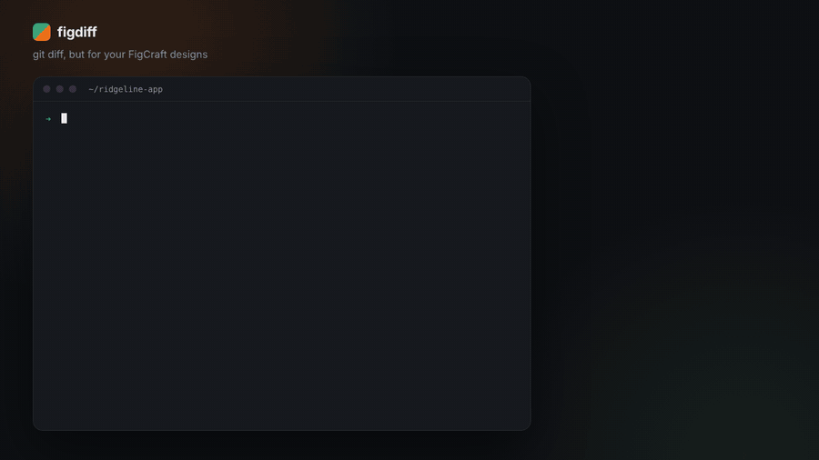

# figdiff

[](https://www.npmjs.com/package/figdiff)
[](https://github.com/bintangyoga/figdiff/actions/workflows/ci.yml)
[](LICENSE)

**Review design changes the way you review code.**

[Website and in-browser diff](https://figdiff.pages.dev) · [Docs](https://figdiff.pages.dev/docs/)



`figdiff` compares two versions of a [FigCraft](https://github.com/storytold/figcraft) design file (`.figcraft`) and explains what changed: a readable list of changes per frame, before/after images, and a pull request comment that stays up to date.

> **Status: alpha.** The CLI, the HTML report (with images rendered by FigCraft's own `figcraft-cli`) and the GitHub Action all work, and are tested in CI. Node matching relies on ids staying stable when FigCraft saves a file again. This holds for FigCraft's example files saved through `figcraft-cli` ([details](docs/compatibility.md)), but not yet checked with the desktop app. Feedback is very welcome: please open an issue.

> **Not affiliated.** figdiff is an independent community project. It is not made by, endorsed by, or connected to the FigCraft / ArtCraft authors. FigCraft is a trademark of its respective owners.

---

## Table of contents

- [Quick start](#quick-start)
- [The problem](#the-problem)
- [The idea](#the-idea)
- [Usage](#usage)
- [How it works](#how-it-works)
- [Who is it for](#who-is-it-for)
- [Roadmap](#roadmap)
- [Risks and open questions](#risks-and-open-questions)
- [Contributing](#contributing)
- [License](#license)

---

## Quick start

Needs Node.js 20 or newer.

```sh
# What changed between two files?
npx figdiff@alpha before.figcraft after.figcraft

# What changed since main? (inside a git repository)
npx figdiff@alpha design/app.figcraft --against main

# A shareable report with a before/after slider (needs figcraft-cli for the images)
npx figdiff@alpha before.figcraft after.figcraft --html report.html --images
```

On GitHub, add the Action and every pull request that touches a design file gets one comment with the changes. See it live in the [demo pull request](https://github.com/bintangyoga/figdiff-demo/pull/1), and read the [CLI guide](docs/cli.md) and the [Action guide](docs/action.md) for every option.

---

## The problem

A `.figcraft` file is a zip archive. When it changes in a Git repository, GitHub and `git diff` can only say "binary file changed". A reviewer has no way to tell whether a designer moved one button or rebuilt a whole screen, short of opening the file in FigCraft and comparing by eye.

Code has diffs, pull request comments, and review tools. Design files, stored in the same repositories, have none of that.

## The idea

figdiff gives design files the same review workflow as code:

- **Semantic diff.** A list of changes in plain language, for example:
  `Frame "Login" › Button "Sign in": fill #2563EB → #1D4ED8`
- **Visual diff.** Before, after, and highlighted-difference images for every frame that changed.
- **Automatic pull request comments.** A GitHub Action that posts both of the above on every pull request that touches a design file.

## Usage

**Compare two files locally**

```sh
npx figdiff before.figcraft after.figcraft
```

```text
Page "App"
  Frame "Components"
    - Landscape › Time=Day › Sun (ellipse)
    ~ Chip › Selected=On › Label: characters All trails → All routes
  Frame "Home — Light"
    ~ Status bar › Indicators › Signal › Bar 1: fills #0F172A → #E6172A
    ~ Status bar › Indicators › Signal › Bar 1: width 3 → 15

4 changes in 2 frames (1 removed, 3 property changes)
```

Useful flags: `--html report.html` also writes a self-contained HTML report (add `--images` for rendered before/after images), `--json` prints the summary and every change as JSON, and `--exit-code` exits with 1 when the files differ, so it can fail a CI step.

**Generate a shareable report**

```sh
npx figdiff before.figcraft after.figcraft --html report.html
```

One self-contained HTML file with the list of changes, filters, and light and dark mode. No server needed, so it can be sent by email or chat to a developer or client. With `--images` (and FigCraft's `figcraft-cli` installed) it also embeds before/after images with a swipe slider and a difference view. This part is experimental: it ran once against the real `figcraft-cli` 0.17.0 in CI on one example file (no warnings, and a report about ten times larger than a text-only one), but nobody has looked at the images yet.

**Compare against another Git branch**

```sh
npx figdiff design/app.figcraft --against main
```

`--against` accepts any git revision (a branch, tag, or commit such as `HEAD~1`). The file is compared with its committed version, so it also works for uncommitted edits: `--against HEAD` shows what you changed since the last commit.

**Use it as a `git difftool`**

```sh
git config difftool.figdiff.cmd 'figdiff "$LOCAL" "$REMOTE"'
git difftool -y -t figdiff main -- design/app.figcraft
```

**Run on every pull request**

The GitHub Action (`action.yml`, currently in alpha) posts one comment per pull request with what changed in each `.figcraft` file, and keeps that comment up to date on every push. Full HTML reports are attached to the workflow run.

```yaml
# .github/workflows/figdiff.yml  (also in examples/figdiff.yml)
name: Design changes
on:
  pull_request:
    paths: ["**/*.figcraft"]

permissions:
  contents: read
  pull-requests: write

jobs:
  figdiff:
    runs-on: ubuntu-latest
    steps:
      - uses: actions/checkout@v4
        with:
          fetch-depth: 0 # needed to read the base commit
      - uses: bintangyoga/figdiff@main
        with:
          files: "design/**/*.figcraft"
```

| Input | Default | Meaning |
| --- | --- | --- |
| `files` | `**/*.figcraft` | Glob patterns (commas or new lines) of the design files to look at |
| `comment` | `true` | `false` writes the reports without commenting |
| `max-files` | `20` | Compare at most this many files per pull request |
| `upload-reports` | `true` | Upload the HTML reports as the artifact `figdiff-reports` |
| `images` | `false` | Experimental: download `figcraft-cli` from the latest FigCraft release and add before/after images to the HTML reports (in the artifact, not in the comment) |
| `scale` | `1` | Render scale for those images, 0.25 to 4 |
| `host-images` | `false` | With `images`: show the images in the comment too, by saving them to a branch of the same repository. Needs `contents: write`. Anyone who can read the repository can see them |
| `assets-branch` | `figdiff-assets` | Branch that holds those images |
| `report-dir` | `figdiff-reports` | Where the reports are written |
| `version` | `latest` | Version of the `figdiff` npm package to use |
| `token` | `github.token` | Token used to comment |

Pull requests from forks get a read-only token, so no comment is posted; the changes are printed in the job log instead. Images appear in the comment only with `images: true` and `host-images: true`, which also needs `contents: write` in the workflow permissions. They are saved on the `figdiff-assets` branch, so the repository will hold a copy of every rendered frame. Without it they are only in the HTML report.

## How it works

```text
before.figcraft ─┐                    ┌─ semantic diff (changes as text/JSON)
                 ├─► parse + match ──►┤
after.figcraft  ─┘                    └─ visual diff (render + compare images)
```

1. **Parser.** Opens the `.figcraft` archive and reads its `document.json` into an internal model. This is the only part that depends on the file format, so it is isolated and versioned.
2. **Differ.** Matches nodes between the two versions (by id, with fallbacks) and produces a list of added, removed, moved, and modified nodes.
3. **Renderer.** Uses FigCraft's own headless CLI (`figcraft-cli`) to render the changed frames to images, then compares them pixel by pixel.
4. **Reporters.** Terminal output, JSON, a self-contained HTML report, and a GitHub pull request comment.

Design principles:

- **Independent.** A separate project. It reads the public file format and uses the public CLI; it does not modify FigCraft.
- **Local-first.** Runs on your machine or in your CI. No accounts, no servers, no telemetry.
- **Resilient to format changes.** FigCraft is in alpha and its format may change. The parser is kept separate from the diff logic and tested against files from multiple FigCraft versions.
- **Useful without Git.** The CLI and HTML report work on any two files.

## Who is it for

- **Developers** who receive design files and want to know what changed since the last version.
- **Design engineers and designers who use Git**, and want design changes reviewed in pull requests.
- **Freelancers and agencies** who exchange versions with clients and need a clear "what changed since last time" report.

---

## Roadmap

Estimated timeline: about 18 weeks to v1.0, assuming one maintainer at roughly 10 hours per week. Each phase ends with a usable release, and the next phase starts only after the exit criteria are met.

| Phase | Weeks | Goal | Release |
| --- | --- | --- | --- |
| 0 | 1–2 | Research and setup | n/a |
| 1 | 3–6 | Semantic diff in the CLI | v0.1.0 |
| 2 | 7–10 | HTML report and visual diff | v0.2.0 |
| 3 | 11–14 | GitHub Action | v0.3.0 |
| 4 | 15–18 | Public launch | v1.0.0 |
| 5 | After v1.0 | Driven by user demand | n/a |

### Phase 0: Research and setup (weeks 1–2)

Confirm that FigCraft's file format and CLI are stable enough to build on, before writing product code.

- [x] Download sample files from FigCraft's `examples/` folder, unzip them, and study the structure of `document.json`
- [x] Document the node schema: id, type, name, parent, position, size, fills, strokes, text, auto layout, components, variables
- [ ] Verify that node ids stay stable when a file is saved again (critical for matching nodes between versions)
- [ ] Test `figcraft-cli render`, `export --node`, and `convert` on headless Linux
- [ ] Check whether `figcraft-cli` is available as a prebuilt binary or must be built with Cargo
- [ ] Check name availability on npm and GitHub; choose a fallback name if needed
- [x] Set up the repository: TypeScript, tests, CI
- [ ] Add linting and formatting (ESLint, Prettier)

**Deliverables:** format notes (`docs/format-notes.md`), 5–10 before/after sample file pairs, a working project skeleton.

**Exit criteria:** the `document.json` schema is understood and node ids are proven stable, or a fallback matching strategy is designed.

### Phase 1: Semantic diff in the CLI (weeks 3–6)

Deliver `figdiff a.figcraft b.figcraft` printing a correct list of changes in the terminal. No images yet.

- [x] Parser for core properties: type, name, hierarchy, position, size, fills, strokes, corner radius, text, font
- [ ] Node matching by id, with fallback to name and hierarchy path
- [x] Detect added, removed, reparented, and modified nodes
- [x] Group results by page and top-level frame so output is easy to read
- [x] Summary line (for example, "12 changes in 3 frames")
- [x] `--json` output for use by other tools
- [x] `--exit-code` flag and stable exit codes (0 ok, 1 differences, 2 error)
- [x] Detect changes in layer order
- [ ] Tests using the sample file pairs from Phase 0

**Release:** `v0.1.0` on npm, usable with `npx figdiff`.

**Exit criteria:** on every sample pair, the list of changes is complete and contains no false changes.

### Phase 2: HTML report and visual diff (weeks 7–10)

Deliver a self-contained HTML report that anyone can open, including designers who do not use Git.

- [x] Self-contained HTML report of the semantic diff (`--html report.html`), with filters and light/dark mode
- [x] Before/after swipe slider and a difference view with the share of changed pixels
- [x] Pixel comparison with highlighted changed areas (own PNG decoder, no dependencies; checked against real FigCraft PNGs)
- [x] A single `report.html` with embedded images and no server
- [x] Graceful fallback when `figcraft-cli` is unavailable: the report is still written, with a warning
- [x] Frames that exist in only one version (added or removed) are shown on their own
- [x] Verify rendering against a real `figcraft-cli` (ran in CI on a FigCraft example without errors; the images themselves still need a human look)
- [ ] Render at 2x as well as 1x
- [x] Side-by-side view next to the swipe slider
- [ ] Semantic change list next to the images; clicking a change highlights its location
- [x] `--against <revision>` (compare a file with its version on a branch, tag or commit) and `git difftool` usage

**Release:** `v0.2.0`, with the first demo GIF in this README.

**Exit criteria:** 3–5 people outside the project open the report and understand the changes without extra explanation.

### Phase 3: GitHub Action (weeks 11–14)

Deliver an automatic comment on every pull request that changes a `.figcraft` file, set up with one workflow file.

- [x] Detect changed `.figcraft` files in a pull request and compare each with its base version
- [x] Install `figcraft-cli` on the runner (`images: true`; downloaded from the FigCraft release and working in the demo repository; no caching yet)
- [x] Pull request comment with a summary and per-frame changes (before/after images with `host-images`; not yet looked at by a human)
- [x] Host images on a dedicated branch (`host-images`; needs `contents: write`)
- [x] Update a single comment on each push instead of posting new ones
- [x] Configuration options: file patterns, file limit, report folder and render scale (comment language still to do)
- [x] Public example repository that uses the Action as a live demo ([figdiff-demo](https://github.com/bintangyoga/figdiff-demo))

**Release:** `v0.3.0` and a listing on GitHub Marketplace.

**Exit criteria:** the Action runs reliably on the example repository and on at least one real project.

### Phase 4: Public launch (weeks 15–18)

Deliver a project that other people can use and contribute to, then announce it.

- [x] Variables, variable collections and styles (tokens) are compared
- [ ] Support for other advanced properties: components and instances as such, variants, prototyping, images (their properties are already diffed generically as node properties)
- [x] Performance testing on large files (a 10,000-node test runs in CI; see `test/performance.test.ts`)
- [x] Compatibility table of tested FigCraft versions ([docs/compatibility.md](docs/compatibility.md)); still to update with each FigCraft release
- [x] Documentation: [CLI guide](docs/cli.md), [Action guide](docs/action.md), [contributor guide](CONTRIBUTING.md)
- [x] `good first issue` labels to welcome contributors (8 issues open)
- [ ] Announcement: FigCraft community, Show HN, Reddit, and design communities

**Release:** `v1.0.0`, with a stable CLI and JSON output format.

### Phase 5: After v1.0

Direction will follow user demand. Candidates:

- **Three-way merge** of design files from different branches, with conflict markers
- **Token and consistency checks** that warn in a pull request about colors or spacing outside the design system
- **Other platforms:** GitLab CI, Gitea, Forgejo
- **MCP server**, so AI agents can ask "what changed in this design?"
- **Automatic design changelog** generated from Git tags
- **Upstream collaboration:** open a diff report directly in FigCraft, if the maintainers are interested

---

## Risks and open questions

| Risk | Impact | Mitigation |
| --- | --- | --- |
| The `.figcraft` format changes (FigCraft is alpha) | Parser breaks on new FigCraft releases | Isolated parser, compatibility table, tests on files from each version |
| Node ids are not stable between saves | Diffs full of false changes | Fallback matching by name and path, validated in Phase 0 |
| `figcraft-cli` is hard to install in CI | Slow or failing GitHub Action | Cache the binary; fall back to semantic diff only |
| FigCraft adds its own diff feature | Less reason to use figdiff | Focus on review in Git and pull requests; talk to the maintainers early |
| Small FigCraft user base | Slow adoption | Start from real needs; keep the core model usable for other formats later |

Open questions:

- Is the project name `figdiff` available on npm and GitHub?
- Does `figcraft-cli` ship as a downloadable binary for Linux, macOS, and Windows?
- How much of FigCraft's built-in `versions/` and `branches/` data is useful to reuse?

## Contributing

Contributions are welcome, even at this early stage. The most useful things right now:

- Feedback on the plan: open an issue with your use case
- Sample `.figcraft` file pairs (before/after) that you are allowed to share
- Notes on the file format, once Phase 0 begins

See [CONTRIBUTING.md](CONTRIBUTING.md) for details.

## License

[MIT](LICENSE)
